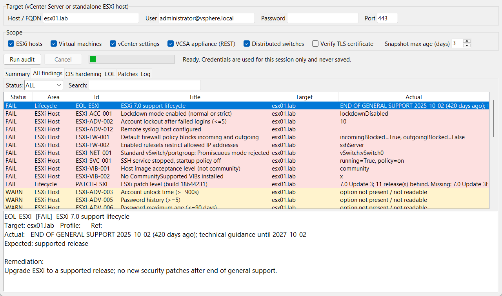
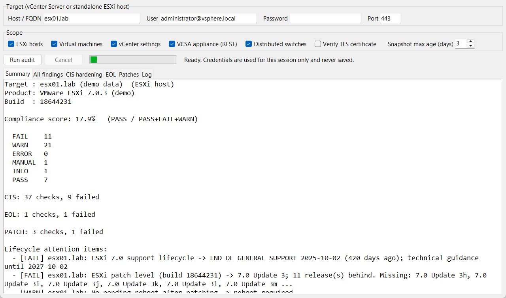

<p align="center"></p>

# VMware vCenter / ESXi CIS, EOL & Patch Auditor

[](https://github.com/3tternp/vmware-vcenter-esxi-cis-audit/actions/workflows/tests.yml)   

Python (Tkinter) GUI that connects read-only to vCenter or a standalone ESXi host and reports:

1. **CIS hardening** – ESXi host (advanced settings, services, lockdown, NTP, firewall, VIB acceptance, vSwitch security), vCenter (advanced settings, banner, admin permissions), VMs (isolation/`extraConfig`, devices, snapshots, tools, RDM), distributed portgroups, and VCSA appliance (SSH/shell/NTP/syslog/password policy via REST).
2. **EOL** – each ESXi host and vCenter release vs. end of general support (bundled table, refreshable from endoflife.date), plus legacy VM hardware versions.
3. **Missing patches** – build number vs. known release builds, pending reboot, VIB inventory, VMware Tools status.

## Screenshots

> Rendered with **demo data** from fake lab objects (`tools/make_screenshot.py`), not a real environment.

| Findings with remediation detail | Summary |
|---|---|
|  |  |

## Install
```powershell
git clone https://github.com/3tternp/vmware-vcenter-esxi-cis-audit.git
cd vmware-vcenter-esxi-cis-audit
pip install -r requirements.txt
```
Requires Python 3.9+ with Tkinter (included with the standard Windows/macOS installers; on Debian/Ubuntu `sudo apt install python3-tk`).

## Usage

### GUI
```powershell
python vmware_audit_gui.py
```
1. Enter the **host/FQDN** of a vCenter Server or a standalone ESXi host, the **user** (e.g. `administrator@vsphere.local`, or `root` for ESXi) and **password**. Port is 443 unless you changed it.
2. Choose the **scope**: ESXi hosts, VMs, vCenter settings, VCSA appliance (REST), distributed switches. Set the maximum snapshot age.
3. Leave **Verify TLS certificate** unchecked only for self-signed lab certificates; tick it in production.
4. Click **Run audit**. Progress and errors appear in the **Log** tab; **Cancel** stops between hosts.
5. Review the tabs: **Summary** (score and attention items), **All findings**, **CIS hardening**, **EOL**, **Patches**. Filter by status, search by text, and select a row to see actual vs. expected values and the remediation command.
6. Use **Export** for an HTML, CSV or JSON report.

Status meanings: `FAIL` non-compliant or unsupported/missing patches · `WARN` review needed or option not present · `MANUAL` cannot be checked via API · `INFO` informational · `ERROR` the check itself failed · `PASS` compliant.

### Keeping EOL and patch data current
- **Data > Fetch EOL dates online** refreshes end-of-support dates from endoflife.date (falls back to the bundled table if offline).
- **Data > Import builds.json / eol.json...** installs your own file into `~/.vmware_audit/`, which overrides the bundled data.

### Command line
```powershell
python vmware_audit_gui.py --cli --host vcenter.example.com --user administrator@vsphere.local [--verify-tls] [--out report]
```
Prompts for the password and writes `report.html`, `report.csv` and `report.json`.

### Self-test (no server needed)
```powershell
python tests/test_mock.py
```

### Regenerate icons and screenshots (needs Pillow)
```powershell
pip install pillow
python tools/make_icons.py
python tools/make_screenshot.py
```

A read-only account is sufficient for vSphere checks; the VCSA appliance checks need an SSO administrator. Credentials are held in memory for the scan only and are never written to disk.

## Important limits
- **Verify data tables.** `vmware_audit/data/builds.json` and `eol.json` are best-effort snapshots. Check them against Broadcom's release notes and Product Lifecycle Matrix, then keep current. Builds newer than the table are reported INFO, not failures. Patch detection is build-based; it does not replace vSphere Lifecycle Manager compliance or VMSA review.
- **CIS numbering.** Checks use their own IDs (e.g. `ESXI-ADV-006`) mapped by topic; CIS renumbers per release. Expected values follow common CIS guidance but confirm against the benchmark version you audit to. Settings not reachable through the API are listed as MANUAL.
- Not yet validated against a live vCenter/ESXi: logic is covered by the mock test only.

## License
[MIT](LICENSE)
